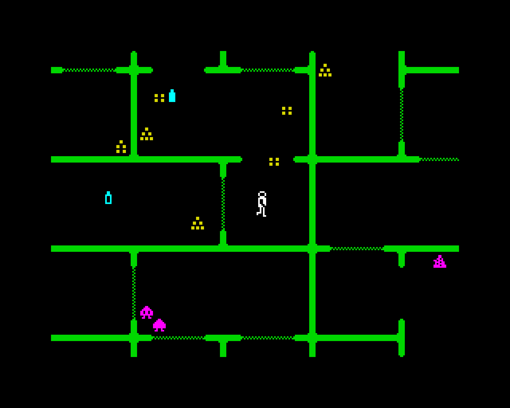
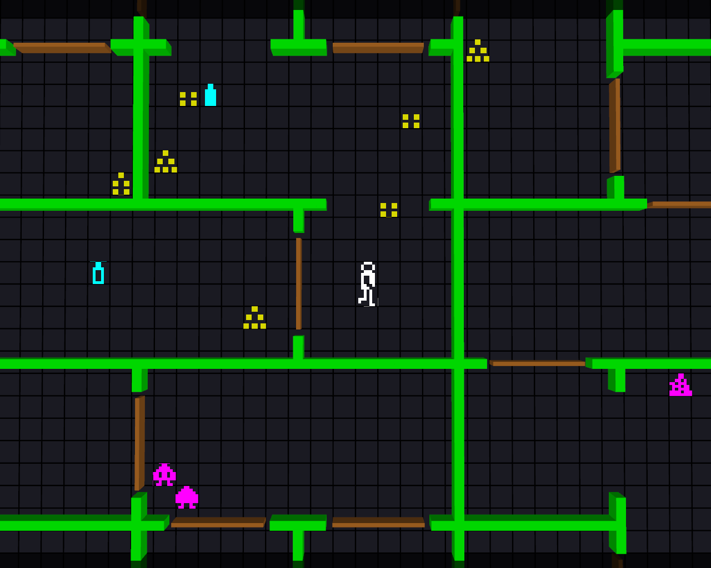

# Halls of the Things - Reborn

A faithful port to .NET 10 of **Halls of the Things** (ZX Spectrum, Crystal Computing /
Design Design, 1983) by **Simon Brattel, Martin Horsley and Neil Mottershead**,
with an optional 3D view seen from above.

> An unofficial, free fan port. The original game and its sources are
> (c) Simon Brattel, Martin Horsley and Neil Mottershead; this port is made from the
> Z80 sources that Simon Brattel published on the [Design Design site](https://www.desdes.com/index.htm).
> They are not copied into this repository: they can be downloaded from there.

| the classic view | the 3D view |
|---|---|
|  |  |

## Why

Halls of the Things is probably my favourite game of the years I spent in front of a
ZX Spectrum. On a plain 8-bit machine, with a few coloured characters on a black
screen, it gave me a real sense of adventure: a maze that was different every time,
halls full of Things that hunted you, a ring found far from the stairs with your
wounds rising and your arrows running out. This port is my way of playing it again,
and of keeping it as it was: the same rules, the same randomness, the same screen,
with a 3D view as an extra for those who want it.

## The game

Eight floors of halls, a new maze every game, and seven rings hidden among them. The
halls are full of Things: they hunt you, they hide in disguise when you are not
looking, and they throw spells of their own. You have a sword, a quiver of arrows,
fireballs, lightning that bounces off the walls and a heal spell, paid for with your
magic. Find the seven rings, and the golden key appears in the sanctuary; take it
back to the way out on floor 0 and you are victorious.

## Download

[Releases](../../releases): `Halls.exe`, one file for Windows x64, nothing to install
(no .NET needed). The settings and the saved game go to `%APPDATA%\HallsOfTheThings`;
the 3D models, if any, to an `Assets\Models` folder next to the exe.

## Credits and thanks

- **Simon Brattel, Martin Horsley and Neil Mottershead**: Halls of the Things,
  Crystal Computing / Design Design, 1983. Design, Z80 code, character set, everything
  that is played here.
- Many thanks to **Simon Brattel** for keeping the old files of Design Design online,
  with the sources of 1983 and of the later versions:
  [desdes.com](https://www.desdes.com/index.htm),
  [old files](https://www.desdes.com/products/oldfiles/index.htm). Without them this
  port, cycle by cycle, could not have been made.
- [raylib](https://www.raylib.com/) by Ramon Santamaria and
  [Raylib-cs](https://github.com/ChrisDill/Raylib-cs).

## What it is

- **The rules of 1983, cycle by cycle.** `Halls.Core` is a transcription of the Z80
  code (through the BBC BASIC rewrite in `src/halls.bas`): the same 32-bit random
  generator (tested against the Z80 instructions), the same maze generator and the
  same order of calls, so a seed should give the same eight floors as the Spectrum
  (not yet checked against a snapshot); the Things, their
  wall following, disguises, arrows, fireballs and bouncing lightning; doors,
  rings, the golden key, the sanctuary, the score. The bugs that change the play are
  kept (spells that hit the Thing that cast them, floors that forget the state of
  their doors). Notes on the original: `docs/halls-analisi.md`.
- **The classic view**: the 32x24 screen of the Spectrum with the character set of
  1983 (`original/halls83_chars.asm`), the screen jumping by 28/21 cells.
- **The 3D view** (F2): the same map seen from above in 3D. Every character can be
  replaced by a model (glTF, OBJ...) without building: see
  [`src/Halls.Game/Assets/Models/README.md`](src/Halls.Game/Assets/Models/README.md).
  What has no model is drawn with boxes or as a card with its 1983 character, so the
  game is whole from the start. Only what the classic screen shows is shown.

Not in 1983, and optional: the strong Things in bright red (R on the front page: on floor f
the first f Things have magic 255 and are faster; disguised ones stay yellow), the modern keys (from the RISC OS version), a screen that
follows the man, the statistics under the map, a high score kept on disk, the
speed (the Spectrum had no clock; 300 cycles of the game loop per second by default).

## Build and play

Needs the .NET 10 SDK.

```
dotnet run --project src/Halls.Game -c Release
dotnet test
dotnet publish src/Halls.Game -c Release -r win-x64 -o dist   # the single exe
```

| key (modern / 1983) | |
|---|---|
| cursor keys (also Z X N M) | move (modern: a tap is one step, held the man walks on) |
| E / O, C | open, close a door (modern: E also keeps what is in front) |
| E, R / K, D | keep, drop |
| CTRL / S | sword |
| W A S D, SPACE / A | arrow: modern W A S D that way, SPACE where the man looks; 1983: 5 6 7 8 choose |
| F, L, H | fireball, lightning, heal |
| TAB / 1 | status |
| C / SPACE | centre the screen; with SHIFT: the screen follows the man |
| I / W | statistics under the map |
| ESC / Q+T+U+I | give up |
| P | map of the floor: only what has been seen, the game stands still (not in 1983) |
| F2, F3 | classic / 3D view, camera (from above, tilted, low) |
| + / -, mouse wheel | 3D zoom, from the classic screen to twice as far |
| F5 | save and quit: the game goes on at the next start, and the save is then deleted (no going back after a death) |
| F11, F12 | full screen, screenshot |

On the front page: M / TAB switch the keys, K redefines the modern keys (a key taken by
another action is swapped with it), R the red Things, + and - the speed. The
settings are kept in `%APPDATA%\HallsOfTheThings\settings.json`, with the window as it was left (position, size, maximized, full screen), the view, the camera and the 3D zoom.

`Halls --3d --seed 7 --floor 1 --screenshot shot.png --frames 120` starts a game,
runs it and saves a picture (to check the graphics).

## Layout

| | |
|---|---|
| `src/Halls.Core` | the game, no graphics: `Game` is the map (BigM), the man, the Things, the projectiles |
| `src/Halls.Game` | raylib (Raylib-cs): front end, classic view, 3D view, models |
| `tests/Halls.Core.Tests` | the generator against the Z80, the floors, the timing of the man, long random games |
| `src/halls.bas`, `riscos/` | the BBC BASIC V + ARM version for the Archimedes |
| `original/` | not in the repository: the sources and tapes of [desdes.com](https://www.desdes.com/products/oldfiles/index.htm), put here to build the character set (`tools/mkchars.py`) |
| `docs/halls-analisi.md` | analysis of the original source (Italian) |
| `tools/` | character set and map tools (Python) |
